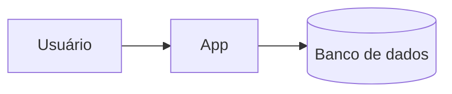

# Arquitetura: <projeto>

## Visão geral
<2–4 linhas>

## Diagrama

## Recursos e serviços
| Recurso/Serviço | Tipo | Finalidade | Status | Notas |
|---|---|---|---|---|

## Decisões
- <decisão>: <motivo>

## Requisitos não funcionais
- <item>

## Pontos em aberto
- <item>
