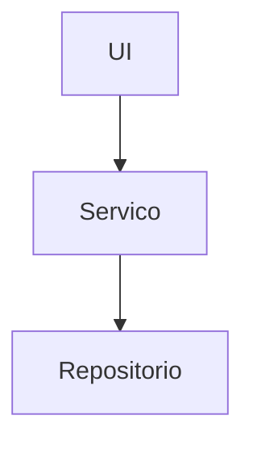

# Design de código: <projeto>

## Princípios
- <princípio>

## Estrutura
```
src/
  <módulo>/   # responsabilidade
```

## Camadas e dependências


## Módulos principais
| Módulo | Responsabilidade | Interface | Colabora com |
|---|---|---|---|

## Padrões e convenções
- Nomes: <regra>
- Erros: <regra>

## Modelo de dados
Ver `banco-de-dados.md`.

## Testes
- <estratégia>

## Pontos em aberto
- <item>
