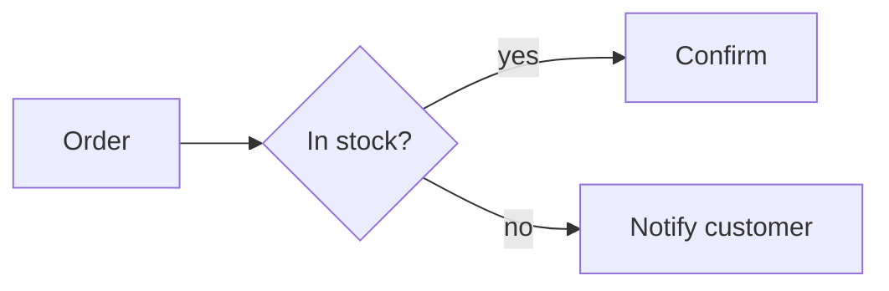

# Simplified communication

Applies to all writing. No exception for format or audience.

Commands are not writing: a command, its arguments and its description never invoke this skill nor follow its rules.

**Always write in English**: replies, documents, headings, table headers, diagram labels and file names this skill creates. Only quoted data keeps its language: code identifiers, existing file names, proper names, text copied from a source.

## Text rules

1. Fewest words that keep the meaning.
2. Direct sentences. No embellishment, detours or introductions.
3. Say each thing once.
4. No closing summary, unless the content is long and the summary adds something new.
5. Precision over brevity: never cut required data, numbers, names or conditions.
6. Prefer list, table or diagram to paragraphs for enumerable or relational content.

## Documentation (.md)

- On a change, rewrite the affected section to the current state; never append.
- Keep only what the file's scope needs.

## When to use Mermaid

Use a diagram when it replaces text and reads faster:

| Content | Mermaid type |
|---|---|
| Process, flow, decision, navigation | `flowchart` |
| Interaction between systems/actors, order in time | `sequenceDiagram` |
| States and transitions | `stateDiagram-v2` |
| Entities and relations | `erDiagram` |
| Classes and dependencies | `classDiagram` |
| Schedule, phases | `gantt` |
| Hierarchy, ideas | `mindmap` |

Do not use when:

- 2–3 linear steps: one sentence is enough.
- Over ~20 nodes: split into `subgraph`s or several diagrams.

## Mermaid rules

1. The diagram replaces the paragraph. Never both.
2. Labels: 1–4 words per node and edge.
3. Label an edge only when not obvious (condition, data passed).
4. `TD` for hierarchy and process, `LR` for short sequences.
5. One idea per diagram.
6. `classDef` only to distinguish node types; no other styling.
7. Always in a ` ```mermaid ` block. Check the syntax before delivering.

Example, instead of "the customer sends the order, the system checks stock and, if available, confirms; otherwise, notifies the customer":



## Checklist before sending

- Words cut without losing data?
- No repetition or needless summary?
- Would a relational or sequential part fit better in Mermaid?
- Diagram replaced the text, not duplicated it?
- Output in English?
