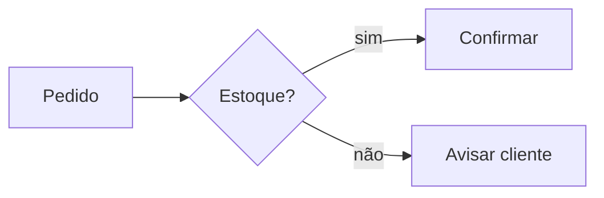

# Simplified communication

Applies to all writing. No exception for format or audience.

**Always write the output in Brazilian Portuguese (pt-BR).** These instructions are in English only to save tokens.

## Text rules

1. Fewest words that preserve meaning.
2. Direct sentences. No embellishment, detours or introductions.
3. No repetition: say each thing once.
4. No closing summary, unless the content is long and the summary adds something new.
5. Precision over brevity: never cut required data, numbers, names or conditions.
6. Prefer list, table or diagram over running paragraphs when the content is enumerable or relational.

## Abbreviations

1. Always prefer the well-known abbreviation over the full term (e.g. `RN`, `API`, `DB`, `UI`).
2. Never use both together: no `Optical Character Recognition (OCR)` and no `OCR (Optical Character Recognition)`. Use the abbreviation alone; the full term lives only in `abreviacoes.md`.
3. Record each abbreviation used in `abreviacoes.md`, in the `docs/` folder of the current project (`repos/<project>/docs/abreviacoes.md`, see skill `project-management`). Create the file if missing.
4. Format: table `Abreviação | Termo completo`, alphabetical, one row per abbreviation, no duplicates. Rewrite to keep it current, do not just append.
5. Only add abbreviations actually used in the project's texts. Never invent an abbreviation.
6. Outside a project (e.g. a reply to the user, a harness file), do not create `abreviacoes.md`; still use the abbreviation alone, without the full term.
7. Feature docs must not contain a glossary (skill `feature-documentation`); `abreviacoes.md` is the only place for abbreviations.

## English terms

- Do not bring English terms into pt-BR text when they lose their meaning in Portuguese; use the Portuguese equivalent.
- Keep an English term only when it is established in Portuguese with the same meaning, or when it is a code identifier, file name, command or proper name.

## Documentation (.md)

- When a change is requested: replace outdated content, never just append on top.
- Documentation does not grow incrementally: rewrite the affected section to reflect the current state.
- Keep the file scope lean.

## When to use Mermaid

Use a diagram when it replaces text and reads faster than it:

| Content | Mermaid type |
|---|---|
| Process, flow, decision, navigation | `flowchart` |
| Interaction between systems/actors, order in time | `sequenceDiagram` |
| States and transitions | `stateDiagram-v2` |
| Entities and relations | `erDiagram` |
| Classes and dependencies | `classDiagram` |
| Schedule, phases | `gantt` |
| Hierarchy, ideas | `mindmap` |

Do not use when:

- There are only 2–3 linear steps: one sentence is enough.
- The diagram repeats the adjacent text: keep only one.
- It exceeds ~20 nodes: split into `subgraph`s or several diagrams.

## Mermaid rules

1. The diagram replaces the equivalent paragraph. Do not duplicate.
2. Short labels: 1–4 words per node and per edge.
3. Label an edge only when not obvious (condition, data passed).
4. Direction `TD` for hierarchy and process, `LR` for short sequences.
5. One idea per diagram.
6. Use `classDef` only to distinguish node types; otherwise no styling.
7. Screen flows: follow the `screen-flow-diagram` skill.
8. Always in a ` ```mermaid ` block. Valid syntax: check before delivering.
9. Node and edge labels in pt-BR.

Example, instead of "the customer sends the order, the system checks stock and, if available, confirms; otherwise, notifies the customer":



## Checklist before sending

- Did I cut words without losing data?
- Is there repetition or an unnecessary summary?
- Would any relational or sequential part fit better in Mermaid?
- Did the diagram replace the text instead of duplicating it?
- Is the output in pt-BR?
- Did I abbreviate known terms and register them in `abreviacoes.md`?
- Did I avoid English terms that lose meaning in Portuguese?
