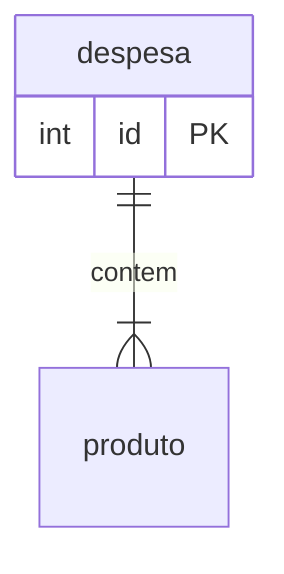

# Banco de Dados

## Dados Físicos

### despesa

| Coluna | Tipo | Constraints | Descrição |
|---|---|---|---|
| id | INTEGER | PK, AUTO_INCREMENT | Identificador único |

### Índices

- `idx_despesa_data` — `despesa(data)` (consultas por período)

## Diagrama ER

## Regras

- <regra de dados>
