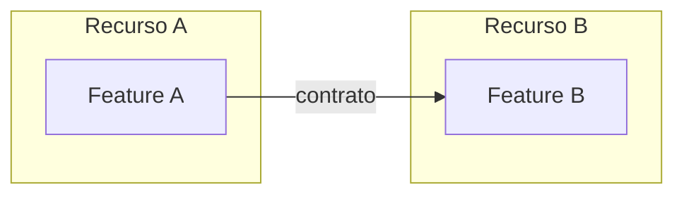

# Mapa de features

## Diagrama

## Features por recurso

| Recurso | Feature | Doc |
|---|---|---|

## Relacionamentos

| Origem | Destino | Interação | Contrato |
|---|---|---|---|

## Regras de interação

- <regra>

## Sem relacionamento

- <feature>: <motivo>
