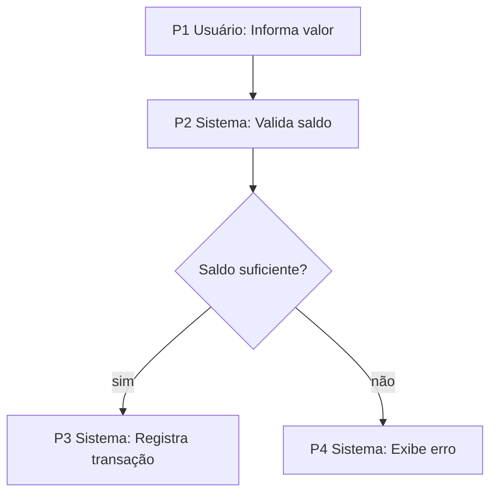

# Feature: <Nome>

## Sobre
<descrição breve>

- **Recurso pai:** <recurso>
- **Tabelas:** <tabela> (omitir se não persiste)

## Input

**Ator:** <quem chama>

| Campo | Tipo | Obrigatório | Descrição |
|---|---|---|---|

## Output

**Ator:** <quem recebe>

| Campo | Tipo | Descrição |
|---|---|---|

## Fluxo

## Regras

- **RN-01** <regra>. Ref: Input.valor, Fluxo.P2
- **RN-02** <regra>. Ref: Output.status, Fluxo.P3

## Mais

### <subseção>
<conteúdo>
