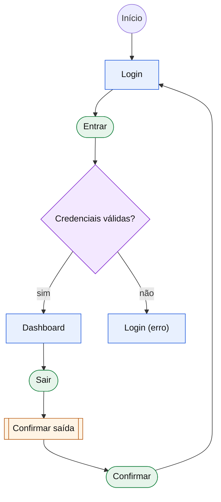

# Fluxo: <Nome>

> Protótipos em `prototipo/`. Este diagrama e os protótipos devem ser atualizados juntos.

## Pareamento com protótipos

| Nó | Tipo | Arquivo | Aberto por |
|---|---|---|---|
| login | tela | prototipo/login.html | — |
| dashboard | tela | prototipo/dashboard.html | btn-entrar |
| modal-confirmar-saida | modal | prototipo/modal-confirmar-saida.html | btn-sair (dashboard) |
